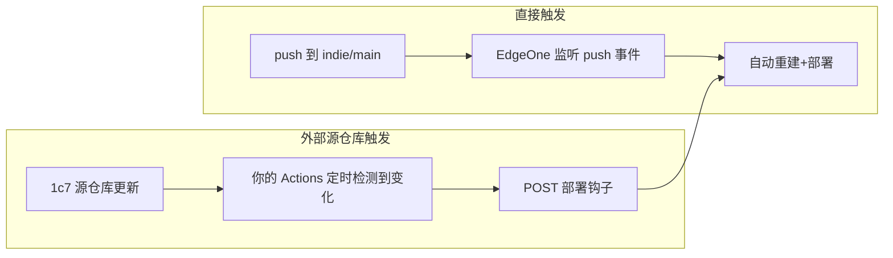

> edgeOne中 从git创建的项目是如何做到，git更新，就重新构建的

好问题。EdgeOne Pages 从 Git 创建的项目之所以能「git 一更新就重新构建」，本质就是**它和你的 GitHub 仓库之间建立了一条自动回调链路**。我先用官方文档确认一下细节，再给你讲清楚原理。
EdgeOne Pages 从 Git 创建的项目，之所以「git 一更新就重新构建」，靠的是**它在你的 GitHub 仓库上自动装了一套「事件订阅 + 自动部署开关」**。下面把链路讲清楚。

## 一、创建时发生了什么（自动建立回调）

你用「导入 Git 仓库」方式建项目时：
1. 通过 GitHub OAuth 授权，EdgeOne 在你的账号/仓库上**安装一个 GitHub App（集成）**；
2. 这个 App 会自动**订阅该仓库的 `push` 事件**（等同于平台在后台帮你建好了一个 webhook，无需你手动配置）；
3. 你选择仓库和**生产分支**（默认 `main`）以及框架。

所以你在本地 `git push` 那一刻，GitHub 会主动发一个事件通知给 EdgeOne —— 这就是「监听推送事件」的本质。

## 二、触发后的判断逻辑（环境 + 自动部署开关）

EdgeOne 每个项目内置两个固定环境：

| 环境 | 关联分支 | 触发效果 |
|---|---|---|
| **生产 (Production)** | 你绑定的生产分支（如 `main`） | 更新线上站点 |
| **预览 (Preview)** | 其它所有分支 / PR 源分支 | 生成独立预览 URL |

而且每个环境都有一个 **「自动部署」开关**（在 `项目设置 → 环境管理 → 编辑环境` 里）：

> 开启后，**每次符合条件的代码提交/合并都会新建一个部署**。

也就是说：
- `git push` 到 `main` → 触发**生产部署**；
- 推到一个功能分支或开 PR → 生成**预览部署**；
- 合并进 `main` → 触发生产部署。

> 如果某天发现「push 了没重建」，先确认这个「自动部署」开关是开着的（默认开，但可能被关掉）。

## 三、EdgeOne 收到事件后做什么

1. 校验事件来源（App 权限/签名）并匹配分支；
2. 拉取该次 commit 的代码；
3. 按 `项目设置 → 构建部署配置` 里的设置跑构建：
   - 根目录、安装命令、构建命令（你的就是 `npm run build`，会先跑 `prebuild` 拉数据）、输出目录（`dist`）、Node 版本、框架预设；
4. 构建产物推到边缘节点，把线上域名指向新版本；
5. 环境变量在 `项目设置 → 环境管理` 里按生产/预览分别配置，只对**新的部署**生效。

## 四、和你这个项目的关联（关键点）

EdgeOne 监听的**只是 `indie` 这个仓库的 push**，它**并不知道也不会去管**外部的 `1c7/chinese-independent-developer`。

所以：
- 你改了 `indie` 的代码并 push 到 `main` → EdgeOne 重建 → `prebuild` 重新拉取源数据 → 部署最新内容 ✅
- 但**源仓库自己更新了** → `indie` 没收到任何 push → EdgeOne 不会动 ❌

这正是上一轮我们做「GitHub Actions 定时轮询源仓库 + 部署钩子」的原因：用一个外部定时器去发现源仓库变化，再主动让 EdgeOne 跑一次构建。走了两条不同的「触发路径」——

简单说：**「git 更新就重建」是 EdgeOne 通过 GitHub App 订阅 push 事件 + 环境「自动部署」开关共同实现的**；而要让「别人仓库更新也重建」，就得在前面再接一层你自己的调度与部署钩子。